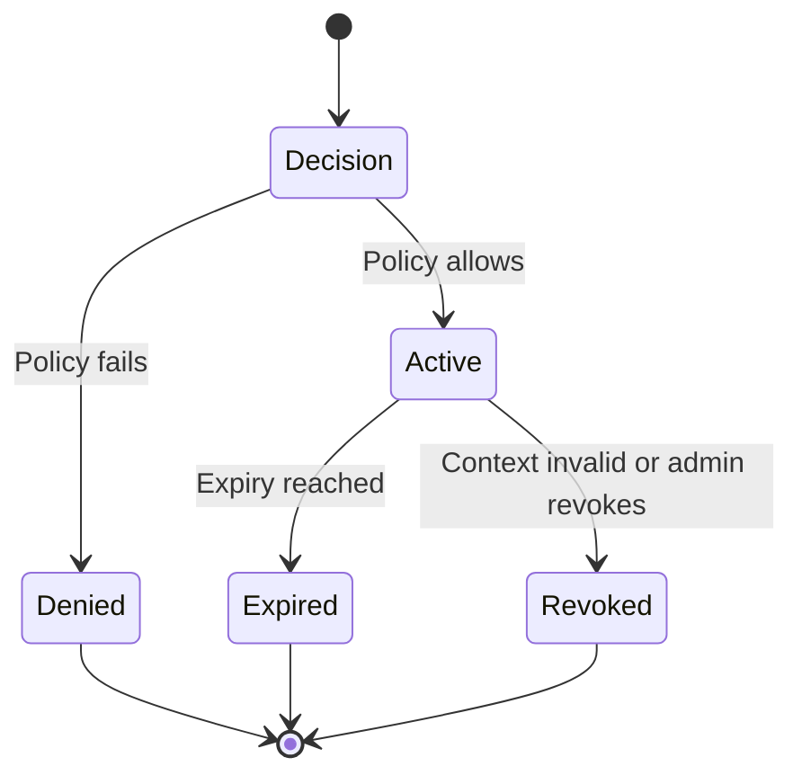

# SIMAP Industrial Policy-to-Session Engine (IPSE)

[](#automated-tests)
**Industrial restricted-zone digital access — executable policy decision sandbox**

> **Status: v0.1 proof of concept. Synthetic inputs only. NOT production access control.**
> No connection to actual industrial assets, customer PTW systems or live identity
> providers. See [SECURITY.md](SECURITY.md).

## 1. Why this project exists

Industrial personnel often need short digital actions—such as a Permit-to-Work
(PTW) acknowledgement or MFA/OTP-related step—in locations where personal
smartphones or unrestricted electronic devices are not permitted. SIMAP explores
a software layer that checks industrial context before approving a temporary,
task-specific session on an approved endpoint.

The proposed core technical mechanism is **policy-to-session orchestration**:
industrial facts about who, where, when, on which device, under which permit and
for which task determine a constrained decision and subsequent session state.
This is a *research and engineering proposition*, not a claim to have invented
existing IAM, ABAC, Zero Trust or temporary-access techniques.

## 2. What is implemented

- Typed input validation using Pydantic v2, including timezone-aware timestamps.
- Versioned JSON industrial policy with allowed roles, sites, zones and tasks.
- Deny-by-default evaluator with explicit machine-readable denial reasons.
- A bounded expiry: earliest of max-session, shift end and permit end.
- In-memory session records bound to user, permit, task, site, zone and device.
- Simulated re-evaluation and revocation when context changes.
- In-memory audit events containing decision, policy version and reason codes.
- FastAPI endpoints, offline CLI, synthetic examples and automated pytest checks.

**Not implemented:** real PTW/identity connectors, secure application gateway,
endpoint isolation, network enforcement, credential revocation, cryptographically
immutable audit records, persistent database, AI or production cybersecurity.
A status change to `REVOKED` means only that a *demonstration record* changed.

## 3. Quick start

Requires Python 3.11+.

```bash
python -m venv .venv
source .venv/bin/activate                 # Windows: .venv\Scripts\activate
python -m pip install -e '.[dev]'
python -m pytest -q
```

Run the offline evaluator:

```bash
simap-demo examples/valid_access.json
simap-demo examples/expired_permit.json
simap-demo examples/unauthorised_zone.json
```

Successful examples return a JSON decision and, if allowed, an in-memory session
record. Denied examples return reason codes without a session.

Start a local-only interactive API:

```bash
python -m uvicorn simap.api:app --host 127.0.0.1 --port 8000
```

Visit `http://127.0.0.1:8000/docs` for OpenAPI interactive documentation.

Example request (separate terminal):

```bash
curl -X POST http://127.0.0.1:8000/v1/access/evaluate \
  -H 'Content-Type: application/json' \
  --data-binary @examples/valid_access.json
```

The response contains `decision.outcome = "ALLOW"`, `reason_codes =
["POLICY_SATISFIED"]`, and a session record with an expiry. This is NOT a real
bearer token or a grant to any enterprise application.

## 4. Policy example

[`policies/ptw_access_policy.json`](policies/ptw_access_policy.json) defines:

```json
{
  "policy_id": "PTW-ACK-001",
  "version": "0.1.0",
  "sites": ["Plant-A"],
  "zones": ["Zone-03"],
  "roles": ["maintenance-contractor", "supervisor"],
  "tasks": ["ptw-acknowledge"],
  "max_session_minutes": 20,
  "require_active_contractor": true
}
```

For the synthetic request at 10:00 UTC with permit end at 12:00 and shift end
at 16:00, the session expiry is 10:20 UTC. If permit expiry is 10:05, the
session ends no later than 10:05. At exact shift/permit end, access is denied.

## 5. Decision rules and reason codes

All conditions must be satisfied: verified identity; approved contractor status
when required; allowlisted role, site, zone and task; approved device; active
shift; valid permit status; and requested time within the permit interval.

| Code | Meaning |
|---|---|
| `IDENTITY_UNVERIFIED` | Identity flag is false |
| `CONTRACTOR_INACTIVE` | Contractor access not active |
| `ROLE_NOT_PERMITTED` | Role not in policy |
| `SITE_NOT_PERMITTED` | Site not in policy |
| `ZONE_NOT_PERMITTED` | Zone not in policy |
| `TASK_NOT_PERMITTED` | Task not in policy |
| `DEVICE_NOT_APPROVED` | Endpoint not approved |
| `SHIFT_NOT_ACTIVE` | Request outside shift |
| `PERMIT_NOT_VALID` | Permit status is not valid |
| `PERMIT_OUTSIDE_WINDOW` | Request outside permit interval |
| `INVALID_SHIFT_WINDOW` | Start not earlier than end |
| `INVALID_PERMIT_WINDOW` | Start not earlier than end |
| `NO_VALID_SESSION_WINDOW` | No positive allowed window |

A denial can have more than one reason. Input schema errors produce HTTP 422.

## 6. Session lifecycle



A session record cannot become active again after expiration/revocation. A
recheck must match the original session's user, permit, task, site, zone and
device, and must still satisfy the current policy. Policy changes must be
coordinated by the integration layer in later releases; current records are
in-memory only.

## 7. API reference

| Method | Path | Function |
|---|---|---|
| GET | `/health` | Sandbox status |
| POST | `/v1/access/evaluate` | Evaluate context and optionally create session record |
| POST | `/v1/sessions/{session_id}/recheck` | Re-evaluate synthetic context |
| GET | `/v1/sessions/{session_id}` | View session record |
| GET | `/v1/audit` | View in-memory audit events |

**All endpoints are unauthenticated demonstration interfaces. Never expose to a
network or populate with real industrial/user data.**

## 8. Automated tests

```bash
python -m pytest -v
```

Tests cover valid access, identity/role/site/zone/task/device failures, inactive
contractor, permit status, shift and permit boundaries, capped expiry, schema
validation, session creation, revocation on permit change, session-context
binding, expiration, idempotent admin revocation, non-extension of session
windows, API success, invalid requests and missing resources. CI runs on
Python 3.11/3.12/3.13 through GitHub Actions.

## 9. Project structure

```text
src/simap/       models, policy evaluation, in-memory sessions, audit, API, CLI
policies/        versioned JSON policy definition
examples/        synthetic allow and deny scenarios
tests/           pytest regression and API tests
docs/            architecture, innovation and development roadmap
SECURITY.md      deployment restrictions and missing controls
```

## 10. Security, IP and project positioning

The code uses *synthetic* records and does not demonstrate actual secure
sessions, local-data erasure or authenticated authoritative attributes. The
industrial security problem requires reliable source verification, verified
endpoint controls and integration with customer policy authorities. These are
future engineering tasks, not covered by passing unit tests.

Refer to [docs/ARCHITECTURE.md](docs/ARCHITECTURE.md),
[docs/INNOVATION.md](docs/INNOVATION.md),
[docs/DEVELOPMENT_ROADMAP.md](docs/DEVELOPMENT_ROADMAP.md) and
[SECURITY.md](SECURITY.md).

**IP note:** Project contributors should confirm ownership and professional IP
strategy before public repository publication. The provisional LICENSE reserves
rights; it is not an open-source licence.

## 11. Next engineering milestones

1. Authoritative signed or authenticated identity/PTW/shift attributes and freshness handling.
2. Real restricted workflow gateway with least-privilege enforcement.
3. Event-driven session revocation and measurable propagation delay.
4. Durable integrity-protected audit records and secure service authentication.
5. Endpoint isolation testing, independent security review and customer-approved pilot integration.

The complete 24-week MVP programme is documented in the SIMAP development plan.
