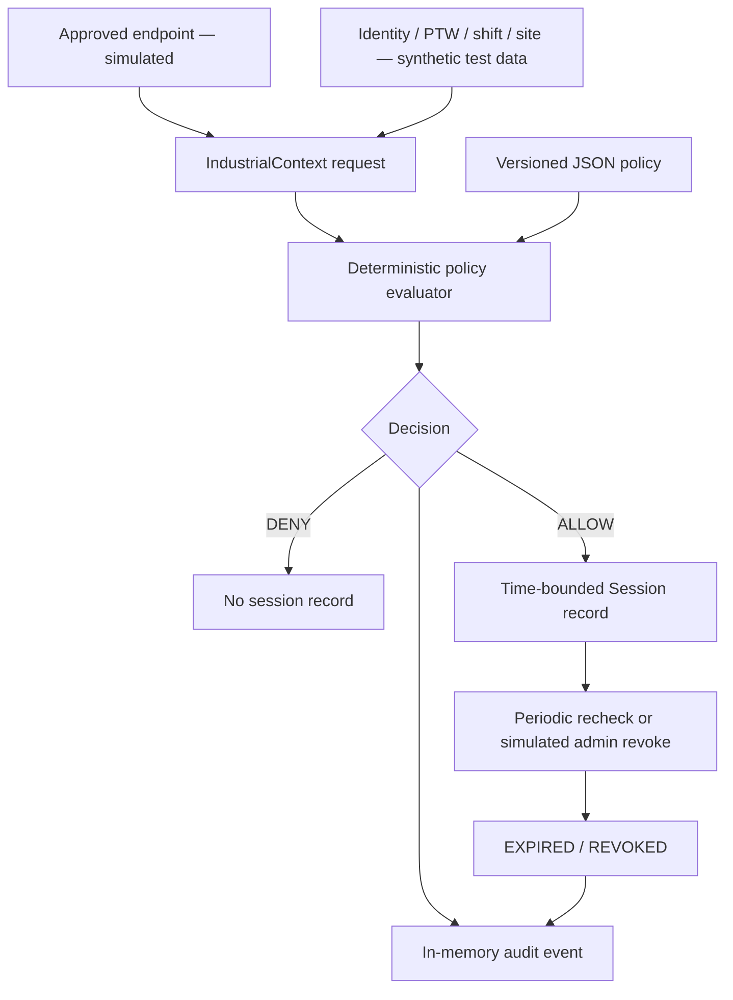

# Architecture — demonstration baseline

## Trust boundary
The synthetic JSON request is assumed trustworthy for a coding demonstration.
That assumption is **unacceptable for production**. In a deployed architecture,
attributes must be acquired from independently authenticated authoritative
sources; the calling device must not be permitted to assert its own approval,
work-permit validity, identity, location or shift status. The FastAPI endpoints
are for loopback demonstrations only.

## Authorization semantics
The sample policy allowlists `Plant-A`, `Zone-03`, role and task combinations.
Deny-by-default means all required conditions must pass. Permit and shift
windows use start-inclusive/end-exclusive comparisons. Expiry is the *minimum*
of the permit deadline, shift deadline and configured maximum duration. The
engine emits explicit reason codes, policy ID and version.

## Session semantics
`SessionManager` records authorised sessions and simulates state transitions:
ACTIVE → REVOKED or ACTIVE → EXPIRED, with no reverse transition. On recheck,
its immutable binding to user, permit, task, site, zone and device is enforced.
Material invalidation revokes a record. It does not implement protected
application sessions, network controls, tokens, encryption or kiosk isolation.

## Demo limitations
The in-memory dictionary and audit store do not survive restart, do not support
multi-process concurrency and are not suitable as an evidence repository.
The demo uses caller-provided time; real enforcement must use trusted server time
and carefully validated input freshness. No actual AI is implemented.
